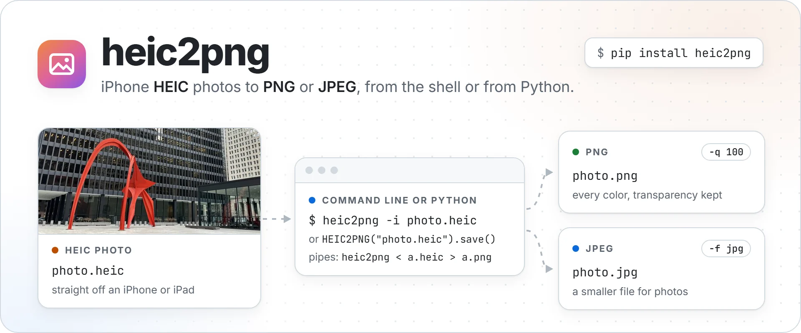
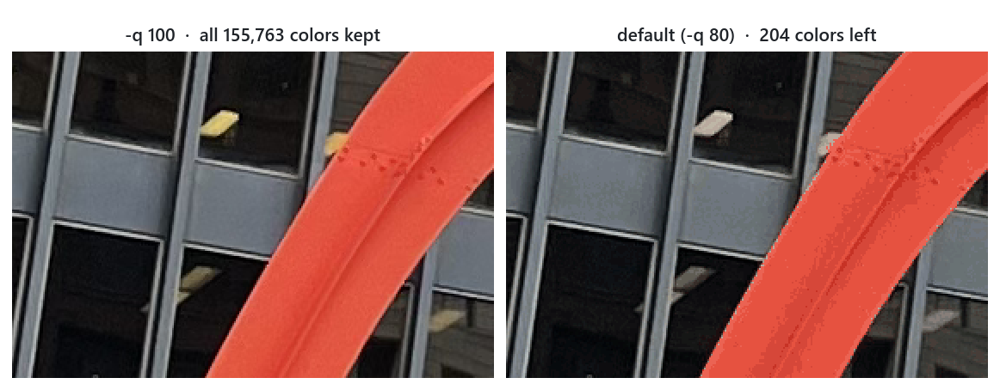

<p align="center">
  <picture>
    <source media="(prefers-color-scheme: dark)" srcset="https://raw.githubusercontent.com/NatLee/heic2png/main/docs/images/hero-dark.webp">
    
  </picture>
</p>

[](https://github.com/NatLee/heic2png/actions/workflows/test.yml)
[](https://pypi.org/project/HEIC2PNG/)
[](https://pypi.org/project/HEIC2PNG/)
[](https://github.com/NatLee/heic2png/blob/main/LICENSE)

Turn iPhone HEIC photos into PNG (or JPEG) from the command line or from Python.
`heic2png` converts a file and puts the result next to it, or works as a filter in a
shell pipe. Transparency is kept, and nothing needs compiling: it is a small wrapper around
[Pillow](https://python-pillow.org/) and [pillow-heif](https://github.com/bigcat88/pillow_heif)
that runs anywhere Python 3.8 or newer does.

## Install

```bash
pip install heic2png
```

## Quick start

```bash
heic2png -i photo.heic                       # writes photo.png next to photo.heic
heic2png -i photo.heic -q 100 -o full.png    # keeps every color (see below)
```

```python
from heic2png import HEIC2PNG

HEIC2PNG("photo.heic", quality=100).save()   # writes photo.png
```

## About quality

The command uses **quality 80 by default**. For PNG output, any quality below 100 turns
the picture into a palette image of at most 256 colors (quality × 2.56). That roughly halves
the file size, but a photo loses color detail. Here is the same 2× crop of the sample photo
in `tests/`, converted both ways:



| Command | Output | Colors | Size |
|---|---|---|---|
| (the original HEIC) | | | 2.4 MB |
| `heic2png -i photo.heic -q 100` | PNG | all 155,763 | 12.4 MB |
| `heic2png -i photo.heic` | PNG | 204 | 6.5 MB |
| `heic2png -i photo.heic -q 30` | PNG | 76 | 4.8 MB |
| `heic2png -i photo.heic -f jpg` | JPEG | all | 2.1 MB |

- **To keep every color, use `-q 100`.**
- **For a small file, use `-f jpg`.** JPEG keeps all colors and is smaller than any palette PNG
  for photos; for JPEG, `-q` is the usual JPEG quality.
- In Python, `HEIC2PNG(path)` keeps every color by default; pass `quality=` to reduce them.

## Command line

```text
usage: heic2png [-h] [-i INPUT_PATH] [-o OUTPUT_PATH] [-q QUALITY]
                [-f {png,jpg,jpeg}] [-w] [--quiet] [-v] [--version]
```

| Option | What it does | Default |
|---|---|---|
| `-i`<br>`--input-path` | Image to convert: `.heic`, `.jpg`, `.jpeg` or `.png` | read stdin |
| `-o`<br>`--output-path` | Where to write the result (stdout when reading stdin) | next to the input |
| `-q`<br>`--quality` | Quality from 1 to 100, see [About quality](#about-quality) | `80` |
| `-f`<br>`--format` | Output format: `png`, `jpg` or `jpeg` | `png` |
| `-w`<br>`--overwrite` | Replace the output file if it exists | off |
| `--quiet` | Print errors only | off |
| `-v`<br>`--verbose` | Also print the settings used | off |
| `-h`<br>`--version` | Print the help or the version | |

`-f` decides the format, not the file name: write `-f jpg -o photo.jpg`, because
`-o photo.jpg` alone still writes PNG data.

```bash
heic2png -i photo.heic -o out.png                   # pick the output path
heic2png -i photo.heic -f jpg                       # writes photo.jpg
for f in *.heic; do heic2png -i "$f" -q 100; done   # every .heic in the folder
heic2png -i photo.heic -w                           # photo.png exists now: -w replaces it
```

Progress messages and errors go to stderr. With `-v` you see what will happen:

```console
$ heic2png -i photo.heic -v
Converting image...
Conversion settings:
Input: photo.heic
Output: photo.png
Quality: 80
Format: png
Overwrite: False
Successfully saved converted image to: photo.png
```

The command exits with 0 on success, 1 when the conversion fails (for example
`heic2png: error: Input file not found: photo.heic`), 2 for invalid options and 130 on Ctrl+C.

## Pipes: stdin and stdout

Without `-i`, `heic2png` reads the image from stdin; without `-o`, it then writes to stdout.
In this mode it prints nothing except errors, so stdout carries only image data.

```bash
cat photo.heic | heic2png > photo.png      # pipe in, pipe out
heic2png < photo.heic > photo.png          # the same with redirects
cat photo.heic | heic2png -o copy.png      # pipe in, write a file
cat photo.heic | heic2png -f jpg -q 90 > photo.jpg

# straight from the web
curl -sL https://github.com/NatLee/heic2png/raw/main/tests/calder-flamingo.heic \
  | heic2png -q 100 > flamingo.png
```

## Python API

```python
from heic2png import HEIC2PNG

converter = HEIC2PNG("photo.heic", quality=100)
converter.save()                                 # photo.png next to the input
converter.save("copy.png")                       # a path of your choice
converter.save("photo.jpg", extension=".jpg")    # JPEG
```

`HEIC2PNG(image_file_path="", quality=None, overwrite=False)` opens the image.

- `image_file_path`: a path (`str` or `Path`) to a `.heic`, `.jpg`, `.jpeg` or `.png` file,
  a binary file object such as `io.BytesIO`, or `""` to read stdin.
- `quality`: `None` (the default) keeps every color. 1–99 reduces PNG output to a palette of
  quality × 2.56 colors; 100 keeps every color. For JPEG output it is the JPEG quality
  (`None` means 95).
- `overwrite`: whether `save()` may replace an existing file.
- Raises `FileNotFoundError` for a missing file, `ValueError` for a bad quality or file type,
  and `OSError` if the data is not an image it can read.

`save(output_image_file_path=None, extension=".png")` converts and writes the image, and
returns the path it wrote.

- `output_image_file_path`: where to write. If left out, the result goes next to the input
  file with the new extension, or to stdout when the input was stdin or a file object.
- `extension`: `".png"`, `".jpg"` or `".jpeg"` (the dot is optional).
- Raises `FileExistsError` if the file exists and `overwrite` is off, `ValueError` for an
  unsupported format, and `OSError` if writing fails.

The opened Pillow image is available as `converter.image` if you need it.

Converting bytes you already have in memory, such as an upload:

```python
import io
from pathlib import Path
from heic2png import HEIC2PNG

data = Path("photo.heic").read_bytes()
HEIC2PNG(io.BytesIO(data), quality=100).save("upload.png")
```

## Development

```bash
git clone https://github.com/NatLee/heic2png.git
cd heic2png
pip install -e ".[test]"   # the package plus pytest
pytest tests               # the tests only write to temporary folders
tox -e py                  # what CI runs: check-manifest + the tests
```

CI runs the tests on Python 3.8 to 3.14.

## Thanks

Built on [Pillow](https://python-pillow.org/) and
[pillow-heif](https://github.com/bigcat88/pillow_heif); colors are reduced with
[`Image.quantize()`](https://pillow.readthedocs.io/en/stable/reference/Image.html#PIL.Image.Image.quantize).
The package layout started from [example_pypi_package](https://github.com/tomchen/example_pypi_package).
The sample photo in `tests/` is Alexander Calder's *Flamingo* in Chicago.

MIT licensed.
